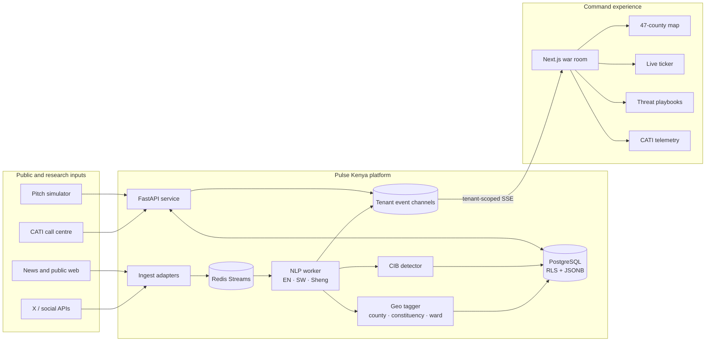
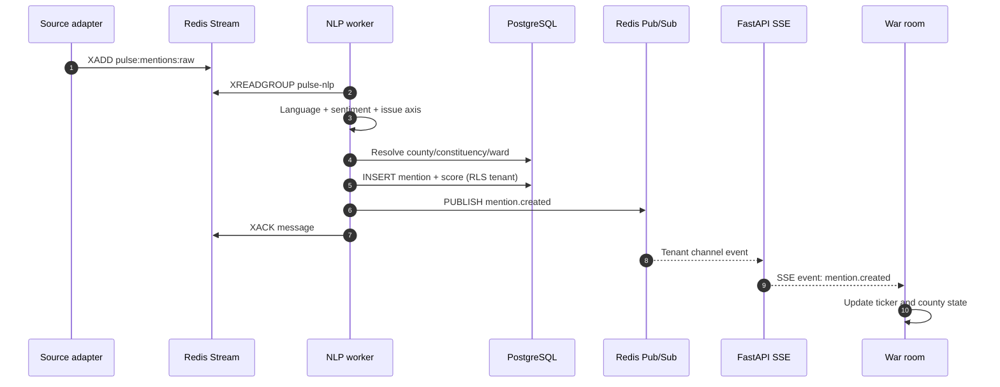
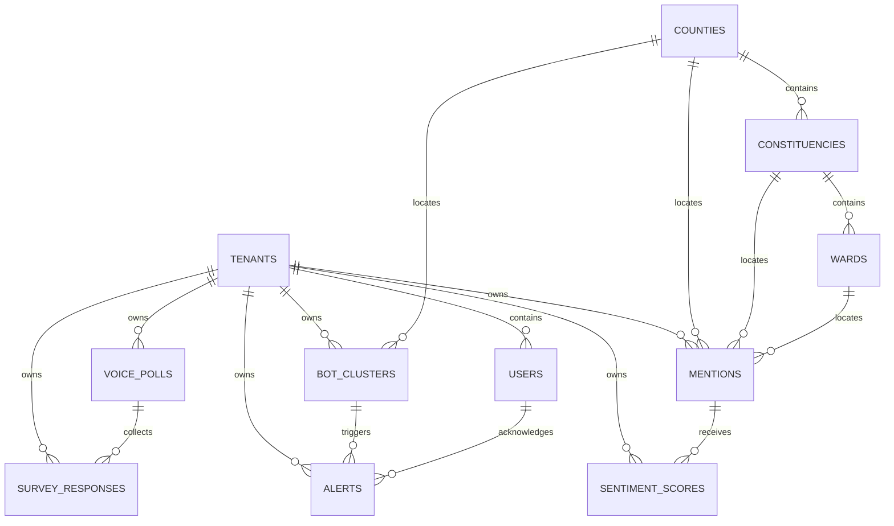

# Pulse Kenya — Public Intelligence MVP

Pulse Kenya by GeoLabs is a runnable, multi-tenant command platform for Kenyan public sentiment, coordinated-influence detection, CATI polling telemetry and live incident simulation. The MVP covers all **47 counties, 290 constituencies and 1,450 wards** and ships with a four-screen war-room interface.

## What is included

- **KP-Sense:** multilingual English/Kiswahili/Sheng signal ingestion, nine issue axes, county filtering and real-time sentiment summaries.
- **KP-Sentry:** coordinated inauthentic behaviour scoring, T1–T4 alerts, evidence fields and 30-minute response playbooks.
- **KP-Voice:** live CATI throughput, contact/completion rates, agent telemetry and quota attainment.
- **KP-Command:** interactive 47-county signal map, public-signal ticker, alert console and a presenter-only narrative injector.
- **Tenant isolation:** PostgreSQL row-level security applies to every customer-owned table. The application binds `app.tenant_id` at transaction start.
- **Real-time transport:** Redis Streams buffer ingestion work; Redis Pub/Sub fans processed mentions and alerts into tenant-scoped SSE channels.

## Quick start

Requirements: Docker Engine with Compose v2 and at least 4 GB of available memory.

```bash
cp .env.example .env
docker compose up --build
```

Open:

- War room: <http://localhost:3001>
- OpenAPI: <http://localhost:8000/docs>
- Readiness: <http://localhost:8000/health/ready>

The development demo is enabled by default. Sign in on the landing page with:

```text
Tenant:   demo
Email:    demo@pulse.ke
Password: PulseDemo!2026
```

## Self-host on your server

Use the dedicated production stack rather than the development Compose override. It provides automatic HTTPS through Caddy, private application/data networks, authenticated Redis, production safety checks, a secret-driven administrator bootstrap and persistent volumes.

Follow [DEPLOYMENT.md](DEPLOYMENT.md). The production entry point is:

```bash
docker compose --env-file .env.production -f docker-compose.production.yml up -d --build
```

To reset the initialized database and replay both schema files:

```bash
docker compose down --volumes
docker compose up --build
```

`down --volumes` removes local PostgreSQL and Redis development data, so use it only when a reset is intended.

## System architecture



### Component responsibilities

| Component | Runtime responsibility | Scaling boundary |
| --- | --- | --- |
| Next.js frontend | Dashboard state, county-wide filtering, SSE client, accessible interactions | Stateless replicas/CDN |
| FastAPI backend | Auth, aggregation queries, crisis injection, CATI and alert actions | Stateless ASGI replicas |
| NLP worker | Redis consumer group, language/issue/sentiment analysis, geo tagging | Independently scaled consumers |
| PostgreSQL | Source of truth, tenant RLS, relational geography and time-indexed signals | Managed primary plus read replicas |
| Redis | Stream buffering, consumer coordination, cache-ready keyspace and SSE fan-out | HA Redis deployment |

The MVP deliberately keeps analytics in indexed PostgreSQL tables. At sustained high ingestion volume, mirror normalized events into ClickHouse and retain PostgreSQL as the control-plane and tenancy source of truth.

## Ingestion and live event sequence



SSE channels use `pulse:events:{tenant_uuid}`. Each connection receives a `connected` event and 15-second comment heartbeats. Redis Pub/Sub makes fan-out work across multiple API processes; clients automatically reconnect using the browser `EventSource` contract. A production ingress must disable proxy buffering and preserve long-lived HTTP responses.

## Data model



The executable schema is in [database/init_schema.sql](database/init_schema.sql). All primary keys are UUIDs. Geography retains official numeric codes as unique lookup keys. `mentions` and `alerts` carry time-oriented composite indexes; flexible evidence, quotas, raw source data and survey answers use JSONB.

### Tenant isolation

Seven customer-owned tables enable PostgreSQL RLS:

```sql
CREATE POLICY tenant_isolation ON mentions
USING (tenant_id = pulse_current_tenant_id())
WITH CHECK (tenant_id = pulse_current_tenant_id());
```

The API connects as the non-owner `pulse_app` role and runs this at the beginning of every tenant transaction:

```sql
SELECT set_config('app.tenant_id', :tenant_uuid, true);
```

The `true` flag makes the value transaction-local, preventing a pooled database connection from leaking tenant state. Application queries also include `tenant_id` predicates where useful for planning and defence in depth. Geography and the tenant slug directory are shared reference data.

## Kenyan geo-taxonomy

The hierarchy seed in [database/kenya_geography_seed.sql](database/kenya_geography_seed.sql) contains all 47 counties, 290 National Assembly constituencies and 1,450 County Assembly wards. IDs are deterministic UUID casts of stable MD5 namespaces, while `code` preserves the 1–47, 1–290 and 1–1,450 election identifiers.

The generated seed validates all three counts inside its transaction and aborts database initialization if any count differs. The generator also corrects the source CSV’s documented `#N/A` transcription for Baringo North, whose position between codes 157 and 159 is constituency code 158.

Data provenance:

- IEBC hierarchy transcription: [pkiage/data-Kenya-Counties-Constituencies-Wards](https://github.com/pkiage/data-Kenya-Counties-Constituencies-Wards)
- Constitutional count cross-check: [IEBC ward methodology](https://www.iebc.or.ke/uploads/resources/9fIr43YjUT.pdf)

To regenerate after downloading the cited CSV:

```bash
python3 scripts/generate_geography_seed.py path/to/csv-Kenya-Counties-Constituencies-Wards.csv database/kenya_geography_seed.sql
```

## API surface

| Method | Endpoint | Purpose |
| --- | --- | --- |
| `POST` | `/api/v1/auth/login` | Tenant-aware password login |
| `POST` | `/api/v1/auth/demo-token` | Local demo token when enabled |
| `GET` | `/api/v1/sentiment/counties` | Shared county taxonomy |
| `GET` | `/api/v1/sentiment/constituencies` | Constituencies, optionally by county |
| `GET` | `/api/v1/sentiment/summary` | Windowed issue-axis aggregation |
| `GET` | `/api/v1/sentiment/mentions` | Recent enriched public signals |
| `GET` | `/api/v1/sentiment/county-map` | 47-county sentiment and threat state |
| `GET` | `/api/v1/alerts` | Sentry alert queue |
| `PATCH` | `/api/v1/alerts/{id}` | Acknowledge, resolve or reopen |
| `GET` | `/api/v1/voice/metrics` | Active CATI poll telemetry |
| `POST` | `/api/v1/pitch/inject-crisis` | Insert a simulated multi-channel crisis |
| `GET` | `/api/v1/pitch/events` | Tenant-scoped SSE stream |

Example injection:

```bash
curl -X POST http://localhost:8000/api/v1/pitch/inject-crisis \
  -H 'Content-Type: application/json' \
  -d '{"county_code":32,"scenario":"cost_of_living","intensity":82}'
```

With demo access enabled, the endpoint uses only the fixed demo tenant when no bearer token is supplied. Set `ALLOW_DEMO_ACCESS=false` outside demonstrations.

## Nine issue axes

`economy`, `healthcare`, `infrastructure`, `corruption`, `education`, `youth_employment`, `security`, `local_leadership`, and `agriculture`.

The included deterministic lexicon engine provides a transparent multilingual baseline and stable demo behaviour. Its `NLPResult` contract is the seam for replacing the baseline with a fine-tuned transformer or external model service. The worker records `model_version` and confidence on every score so backfills and model comparisons remain auditable.

## Development without Docker

Backend (requires reachable PostgreSQL and Redis configured in `.env`):

```bash
cd backend
python -m venv .venv
. .venv/bin/activate
pip install -r requirements.txt
uvicorn main:app --reload
```

Frontend:

```bash
cd frontend
npm ci
npm run dev
```

Useful verification commands:

```bash
python -m compileall backend
cd frontend && npm run typecheck && npm run build
docker compose config --quiet
```

## Production hardening checklist

- Replace local credentials and rotate `JWT_SECRET`; store them in a managed secret service.
- Disable demo access and place simulation endpoints behind an explicit presenter/operator entitlement.
- Add source-specific consent, retention and lawful-basis controls; never use the platform for individual political profiling.
- Run migrations through Alembic rather than replaying Docker initialization SQL.
- Put PostgreSQL and Redis on private networks with TLS, backups, point-in-time recovery and monitored failover.
- Add rate limiting, audit events, token revocation, SSO/OIDC and MFA for operator accounts.
- Enforce source API terms, redact direct identifiers, hash respondent identities and define deletion SLAs.
- Add model evaluation by language, county and issue axis; human-review all T3/T4 actions.
- Export structured logs, traces, stream lag, SSE client counts, failed jobs and query latency to observability tooling.

## Repository layout

```text
backend/    FastAPI service, domain models, analysis services and Redis workers
frontend/   Next.js App Router command UI
database/   PostgreSQL/RLS schema and complete Kenya geography seed
scripts/    Deterministic geography seed generator
```

# Kenya-Campaign-Pulse
